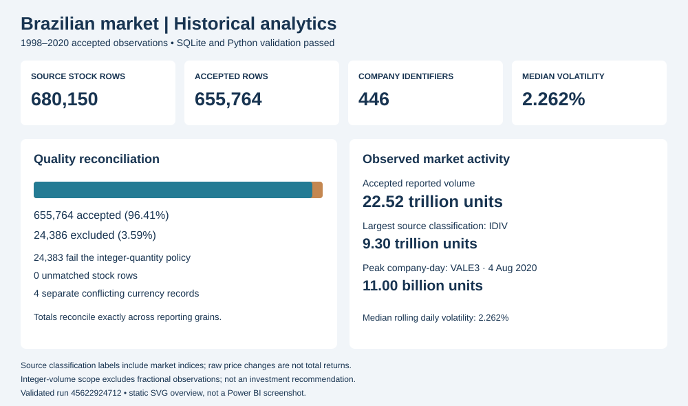

# Brazil Stock Market — Star Schema Data Warehouse

## Overview
This project designs and implements a **star schema** data warehouse for the
Brazilian Stock Market dataset (1994–2020), sourced from Kaggle
(`Brazil Stock Market - Data Warehouse`). The model follows Kimball's (2013)
star-schema approach: a central fact table holding numeric measures and
foreign keys, surrounded by descriptive dimension tables.

## Data Model
The dataset is split into **2 fact tables** and **3 dimension tables**:

| Table         | Type      | Description                                  |
|---------------|-----------|-----------------------------------------------|
| `factCoins`   | Fact      | Currency (coin) value over time                |
| `factStocks`  | Fact      | Stock prices (open/close/high/low/volume)      |
| `dimTime`     | Dimension | Calendar attributes (day, month, quarter, etc.)|
| `dimCoin`     | Dimension | Currency reference data                        |
| `dimCompany`  | Dimension | Company / sector / segment reference data      |

**Relationships**
- `factCoins` → `dimTime` (via `keyTime`), `dimCoin` (via `keyCoin`)
- `factStocks` → `dimTime` (via `keyTime`), `dimCompany` (via `keyCompany`)

## Files
- `schema.sql` — DDL to create the star schema (dimension + fact tables, PK/FK, indexes).
- `analysis.sql` — Analytical queries reproducing the project's workflow:
  1. Joining `factStocks`/`factCoins` with `dimTime` and `dimCompany`.
  2. Calculating a new **daily percentage change** column:
     `((close - open) / open) * 100`.
  3. Aggregating (pivoting) the daily percentage change **by sector** to
     find average sector performance.
  4. Sample queries answering the project's business questions (stock
     values on a given day, trading volume by weekday, top companies by
     high value).

## Why Star Schema (over Snowflake / 3NF / Data Vault)
- High query performance via denormalized joins — good fit for historical
  data analysis.
- Simple and easy to understand for BI/reporting tools (e.g., Tableau).
- Trade-off: less flexible to schema changes and some data redundancy,
  which is acceptable given the historical, largely static nature of this
  dataset.

## Business Questions Answered
1. What was the opening/closing/high/low value of a stock on a given day?
2. What was the exchange rate of a currency on a given day?
3. Which days of the week had the highest trading volume?
4. How did different companies/sectors perform over time?

## Tools Used
- SQL (schema design, joins, aggregation)
- Excel (initial exploration, calculated columns, pivot tables)
- Tableau (dashboarding — see original presentation for dashboard screenshots)

## Challenges
- Understanding stock market terminology.
- Identifying relationships/keys between tables.
- Large historical volume (1994–2020).
- Maintaining two separate fact tables (factCoins, factStocks) increased
  analysis time and modeling complexity.

## Recommendations
- Diversify investments across sectors to mitigate sector-specific risk.
- Use daily percentage change as a volatility/trend indicator.
- Check correlation between stocks before building a portfolio to avoid
  concentrated risk.

## References
- Kimball, R. (2013). *The Data Warehouse Toolkit: The Definitive Guide to
  Dimensional Modeling*. Wiley.
- Taylor, D. (2020). *What is Star Schema in Data Warehouse modeling?*
  guru99.com.
- Kaggle. (n.d.). *Brazilian Stock Market - Data Warehouse.*
  https://www.kaggle.com/datasets/leomauro/brazilian-stock-market-data-warehouse

## Historical analytics upgrade
See [analytics_v2](analytics_v2/README.md) for the loader, quality checks, rolling statistics, monthly and yearly returns, DAX and findings generation. The original dataset has been downloaded and analyzed in a successful validation run. Native Power BI workbook is not included.

## Verified historical analysis — 25 November 2026

[Five calculated findings and data-quality limitations](analytics_v2/verified_findings.md) · [Successful validation](https://github.com/Krgaurav93084/Brazil-Stock-Market-StarSchema/actions/runs/45622924712) · [Generated PNG and CSV results](https://github.com/Krgaurav93084/Brazil-Stock-Market-StarSchema/actions/runs/45622924712/artifacts/15026451655) (retention applies).
680,150 source stock records, 655,764 accepted observations, 446 company identifiers. Reconciliation uses exact integer volume; 24,386 rows excluded, including 24,383 outside the integer-volume policy. Source classifications are not necessarily industries. Report is a historical analytical case study, not an investment recommendation or Power BI Desktop screenshot.
